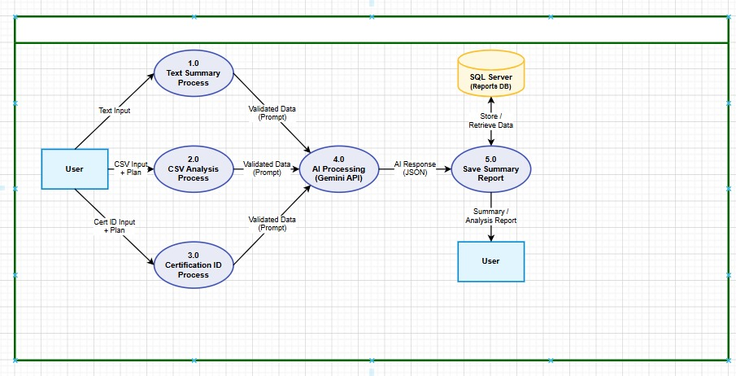
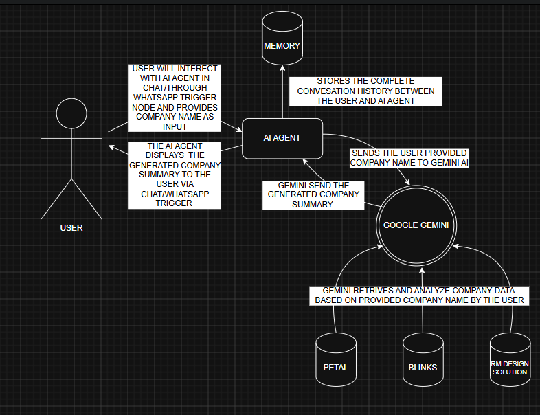
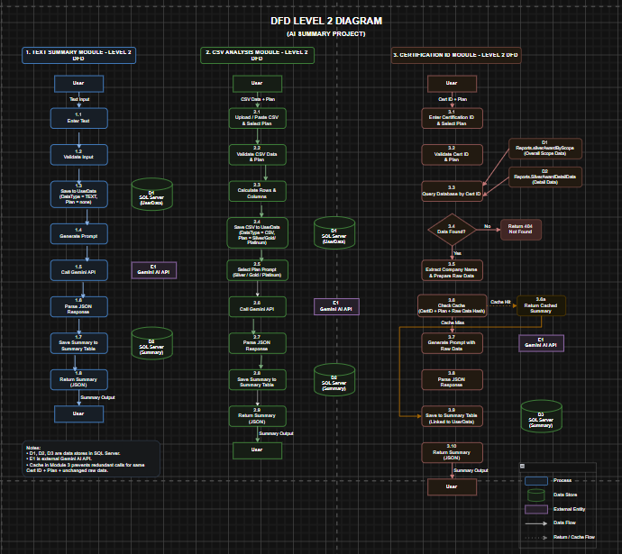

# Practical 1 – Understanding the Data Engineering Lifecycle

**Course:** Data Engineering (ITUC301)  
**Institution:** Charotar University of Science & Technology  
**Department:** Devang Patel Institute of Advance Technology and Research (DEPSTAR)  
**Student Name:** Nandan Vakani  
**Student ID:** 24DIT074  
**Semester:** ODD Semester 2026–27

---

## Table of Contents

- [Problem Definition](#problem-definition)
- [Dataset & Tools](#dataset--tools)
- [Lifecycle Architecture Overview](#lifecycle-architecture-overview)
- [Five Core Lifecycle Stages](#five-core-lifecycle-stages)
- [System Manifesto – Lifecycle Undercurrents](#system-manifesto--lifecycle-undercurrents)
- [Architecture Diagrams](#architecture-diagrams)
- [Key Question Answers](#key-question-answers)
- [Post-Lab Summary](#post-lab-summary)

---

## Problem Definition

Study, dissect, and map the complete end-to-end data engineering lifecycle for an enterprise e-commerce platform. Trace data states across all five core lifecycle stages: **data generation, ingestion, storage, transformation, and serving**.

The solution includes:
- A detailed architectural data flow diagram
- A system manifesto documenting cross-cutting lifecycle undercurrents (security, observability, and data privacy)
- All files committed to this Git repository

---

## Dataset & Tools

| Item | Details |
|------|---------|
| **Dataset** | Mock enterprise e-commerce dataset schema — transactional database entities, clickstream tracking JSON payloads, and third-party inventory log streams |
| **Diagram Tool** | Draw.io |
| **Version Control** | Git + GitHub |

---

## Lifecycle Architecture Overview

The data engineering lifecycle for an enterprise e-commerce platform flows through five sequential stages. Each stage feeds the next, and three undercurrents — **security**, **observability**, and **data privacy** — run across all of them.

```
┌────────────────┐     ┌───────────────┐     ┌─────────────┐     ┌──────────────────┐     ┌─────────────┐
│  GENERATION    │ --> │  INGESTION    │ --> │   STORAGE   │ --> │  TRANSFORMATION  │ --> │   SERVING   │
│                │     │               │     │             │     │                  │     │             │
│ • Orders DB    │     │ • CDC         │     │ • Data Lake │     │ • Clean / Dedupe │     │ • Dashboards│
│ • Clickstream  │     │ • Kafka Stream│     │ • Warehouse │     │ • Enrich / Join  │     │ • SQL Marts │
│ • Inventory    │     │ • Batch API   │     │ • Tiered    │     │ • Aggregate      │     │ • ML Models │
└────────────────┘     └───────────────┘     └─────────────┘     └──────────────────┘     └─────────────┘

                 ◄──────────────── Security · Observability · Data Privacy ────────────────►
```

---

## Five Core Lifecycle Stages

### 1. Data Generation

In an enterprise e-commerce platform, data is generated from three primary source systems:

- **Transactional Database** – Records customer orders, payments, product details, and inventory changes as structured relational records (SQL tables).
- **Clickstream Tracking System** – Captures user behavior on the website and mobile app as JSON payloads, logging every page view, product click, cart addition, and session event.
- **Third-Party Inventory Log Streams** – Pushes continuous stock updates and supplier data as streaming log feeds.

Each source generates data at a different speed, volume, and structure, which directly shapes the downstream pipeline design.

---

### 2. Data Ingestion

Ingestion moves raw data from source systems into the pipeline:

| Source | Ingestion Method |
|--------|-----------------|
| Transactional DB | Change Data Capture (CDC) — captures row-level INSERTs, UPDATEs, DELETEs in real time |
| Clickstream JSON | Apache Kafka streaming — continuous high-frequency event ingestion |
| Inventory Logs | Scheduled batch API pulls at defined intervals |

The ingestion layer handles schema variations, data volume spikes, and network failures gracefully, ensuring no data is lost in transit.

---

### 3. Storage

Ingested data is organized into tiered storage zones:

| Zone | Storage Type | Contents |
|------|-------------|----------|
| **Raw Zone** | Object Storage (S3 / MinIO) | Unprocessed data, partitioned by source and date |
| **Processed Zone** | Analytical Warehouse (DuckDB / PostgreSQL) | Cleaned, structured data ready for querying |
| **Hot Tier** | SSD-backed fast storage | Last 90 days of active data |
| **Warm Tier** | Standard object storage | 90–365 days of infrequent data |
| **Cold Tier** | Compressed archive storage | Data older than 1 year |

Storage design is driven by what the serving layer needs — if analysts query three years of order history, data must be partitioned by date and region to avoid full-table scans.

---

### 4. Transformation

Transformation converts raw data into clean, enriched, analytically ready formats:

- **Deduplication** – Remove duplicate records caused by retry mechanisms in ingestion
- **Standardization** – Normalize date formats, currency values, and categorical fields
- **Enrichment Joins** – Join clickstream events with customer profile records from the transactional DB
- **Aggregation** – Compute daily/weekly sales metrics, user engagement scores, and inventory turnover rates
- **Business Rules** – Apply logic such as customer segmentation by purchase frequency

An **ELT approach** is used — raw data lands in storage first, and transformations are applied inside the warehouse engine using SQL, leveraging the warehouse's compute power.

---

### 5. Serving

The serving layer delivers transformed data to end consumers:

| Consumer | Serving Method |
|----------|---------------|
| Business Analysts | SQL-accessible data marts with masked PII |
| Dashboards | Pre-aggregated summary tables (refreshed hourly) |
| Machine Learning Models | Feature tables exported from the warehouse |
| Operational Tools (CRM, ERP) | Reverse ETL — push computed metrics back into operational systems |

The performance, latency, and format requirements of the serving layer directly dictate every decision made in the upstream stages.

---

## System Manifesto – Lifecycle Undercurrents

Security, observability, and data privacy are not added at the end — they are enforced at **every boundary** between lifecycle stages.

---

### Security

| Lifecycle Boundary | Security Control |
|-------------------|-----------------|
| Generation → Ingestion | Authenticated, TLS-encrypted connections from source systems; no hardcoded credentials |
| Ingestion → Storage | Only authorized pipeline services have write access to the raw zone; PII fields tagged on arrival |
| Storage → Transformation | Transformation jobs run under least-privilege service accounts; raw storage access is audited |
| Transformation → Serving | Only masked data reaches the serving layer; Role-Based Access Control (RBAC) applied to all views and marts |

---

### Observability

| Lifecycle Boundary | Observability Control |
|-------------------|--------------------|
| Generation → Ingestion | Source systems emit health metrics (record counts, event rates); alerts fire on unexpected volume drops |
| Ingestion → Storage | Every job logs start time, end time, records processed, and errors; alerts on pipeline failure or count deviation |
| Storage → Transformation | Data freshness monitored; alert fires if transformation jobs consume stale data |
| Transformation → Serving | Query performance, dashboard load times, and API response times monitored; slow queries trigger upstream review |

---

### Data Privacy

| Lifecycle Stage | Privacy Control |
|----------------|----------------|
| Generation | PII fields (name, email, address, payment details) flagged at the schema level; collected only with user consent |
| Ingestion | PII fields identified and tagged in metadata; raw PII never written to unsecured storage |
| Storage | PII encrypted or tokenized at rest; data retention policies define maximum holding periods |
| Transformation | PII masked or hashed before writing to the analytical layer; surrogate keys replace business identifiers |
| Serving | Analysts access only masked/aggregated data; all access logged for GDPR/compliance audits |

---

## Architecture Diagrams

The solution is documented through three architectural diagrams covering the AI Summary Generator system — the internship project mapped to the data engineering lifecycle.

---

### Diagram 1 – DFD Level 1 : System Overview

This diagram shows the top-level data flow across the three processing modules (Text Summary, CSV Analysis, Certification ID), the central AI Processing unit (Gemini API), and the output storage and serving layer (SQL Server → User).



**Lifecycle Mapping:**

| DFD Element | Lifecycle Stage |
|-------------|----------------|
| User inputs (Text, CSV, Cert ID) | Data Generation |
| Process nodes 1.0 / 2.0 / 3.0 | Data Ingestion & Validation |
| 4.0 AI Processing (Gemini API) | Transformation |
| SQL Server (Reports DB) | Storage |
| 5.0 Save Summary Report → User | Serving |

---

### Diagram 2 – DFD Level 0 : AI Agent Architecture

This diagram shows the high-level context — how the User interacts with the AI Agent via Chat/WhatsApp trigger, how the agent sends the company name to Google Gemini, how Gemini retrieves and analyzes data from three company databases (Petal, Blinks, RM Design Solution), and how the Memory module stores the conversation history.



**Lifecycle Mapping:**

| DFD Element | Lifecycle Stage |
|-------------|----------------|
| User providing company name via WhatsApp/Chat | Data Generation |
| AI Agent receiving input & Memory storing history | Data Ingestion & Storage |
| Google Gemini retrieving & analyzing company data | Transformation |
| AI Agent returning generated summary to User | Serving |

---

### Diagram 3 – DFD Level 2 : Detailed Module Flows

This diagram provides granular process-level detail for all three modules:

- **Module 1 – Text Summary:** User enters text → validate → generate prompt → call Gemini API → parse JSON → save to Summary Table → return output
- **Module 2 – CSV Analysis:** Upload/paste CSV + select plan → validate → calculate rows → save to UserData → select plan prompt → call Gemini API → parse → save → return output
- **Module 3 – Certification ID:** Enter Cert ID + plan → validate → query DB → check cache → if cache hit return cached summary; if miss → extract company data → generate prompt → call Gemini API → parse → save to Summary Table → return output



**Lifecycle Mapping:**

| DFD Element | Lifecycle Stage |
|-------------|----------------|
| User inputs across all three modules | Data Generation |
| Validate Input / Upload CSV / Enter Cert ID steps | Data Ingestion |
| D1 UserData, D2 UserData, D3 UserData (SQL Server) | Storage – Raw Zone |
| Gemini API call + Parse JSON Response steps | Transformation |
| D4/D5 Summary Tables + Return Summary (JSON) → User | Storage (Processed) + Serving |
| Cache check in Module 3 | Storage Optimization |

---

## Key Question Answers

### Q1: How do the technical demands of downstream serving layers directly influence ingestion and storage design decisions during the early generation phases?

The serving layer is the final consumer of data, and its requirements ripple backwards through every earlier stage of the lifecycle. If the serving layer needs real-time dashboards updated every few seconds, the ingestion layer cannot use nightly batch jobs — it must implement continuous streaming ingestion. If analysts need to query five years of sales data broken down by region and product category, the storage layer must partition data using those exact dimensions (region, product category, date) to avoid slow full-table scans. If machine learning models at the serving layer require enriched customer profiles combining clickstream behavior with purchase history, the transformation layer must produce those joins, and the ingestion layer must ensure both data streams arrive with aligned timestamps.

In short, ingestion and storage cannot be designed in isolation — the serving layer's demands for latency, query patterns, data freshness, and data structure must be understood first, and every upstream stage must be designed to satisfy those requirements.

---

### Q2: Differentiate between the broader data lifecycle and the technical data engineering lifecycle within an enterprise.

**Broader Data Lifecycle** refers to the complete journey of data from the moment it is created as a business event all the way through its use, archiving, and eventual deletion. It includes business-level stages such as data creation, data capture, data processing, data analysis, data publishing, and data archiving or disposal. This lifecycle is governed by organizational policies, legal compliance requirements, and business objectives. It addresses questions like: who owns this data, how long must we keep it, and what are we legally permitted to do with it?

**Technical Data Engineering Lifecycle** is a subset of the broader lifecycle. It focuses specifically on the engineering stages a data engineer is responsible for: data generation (interfacing with source systems), ingestion (moving data reliably into the platform), storage (organizing and persisting data efficiently), transformation (cleaning and reshaping data for analysis), and serving (delivering data to consumers). While the broader lifecycle includes governance, legal, and business concerns, the technical lifecycle is concerned with systems, pipelines, tools, and architectural patterns that make data reliably available for analytical and operational use.

---

### Q3: Identify how the undercurrents of security and data observability should be enforced at each lifecycle boundary.

Security and observability are not features added at the end of a pipeline — they are undercurrents that must be built into every boundary between lifecycle stages.

**Generation → Ingestion:** Security requires that source systems authenticate themselves before pushing data, and that all data in transit is encrypted. Observability requires logging the volume and frequency of incoming data so that missing or delayed feeds are detected immediately.

**Ingestion → Storage:** Security requires that only authorized pipeline services have write access to the raw storage zone, and that PII fields are tagged or masked before landing. Observability requires that every ingestion job logs its completion status, record counts, and any schema anomalies encountered.

**Storage → Transformation:** Security requires that transformation jobs run under least-privilege service accounts and that access to raw storage is audited. Observability requires monitoring data freshness — if transformation jobs consume yesterday's data when they expected today's, an alert must fire.

**Transformation → Serving:** Security requires that only clean, masked data reaches the serving layer and that role-based access controls are applied to all views and data marts. Observability requires tracking query performance, data staleness at the serving layer, and any unauthorized access attempts.

Enforcing these undercurrents at every boundary — rather than only at the entry or exit point of the pipeline — ensures that a failure or breach at any single stage does not compromise the integrity or security of the entire system.

---

## Post-Lab Summary

### Lifecycle Design Selections

| Stage | Design Choice | Reason |
|-------|--------------|--------|
| Ingestion (Transactional) | CDC-based real-time | Captures every row change with minimal source load |
| Ingestion (Clickstream) | Apache Kafka streaming | Handles high-frequency JSON event bursts reliably |
| Ingestion (Inventory) | Scheduled batch API pull | Inventory updates are periodic, batch is sufficient |
| Storage Architecture | ELT with tiered zones | Leverages warehouse compute; separates raw from clean data |
| Transformation Approach | ELT using SQL inside warehouse | Simpler maintenance; warehouse handles compute scaling |
| Serving | Data marts + Reverse ETL | Analysts get clean marts; operational tools get synced metrics |

### Key Takeaway

The most important insight from this practical is that **data engineering lifecycle design is not linear** — you must understand the serving layer requirements first and design backwards. Latency needs, query patterns, and privacy requirements at the serving end determine every architectural decision in ingestion, storage, and transformation.

---

*Practical 1 | ITUC301 Data Engineering | DEPSTAR, CHARUSAT | ODD Semester 2026–27*
